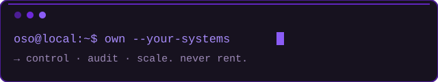
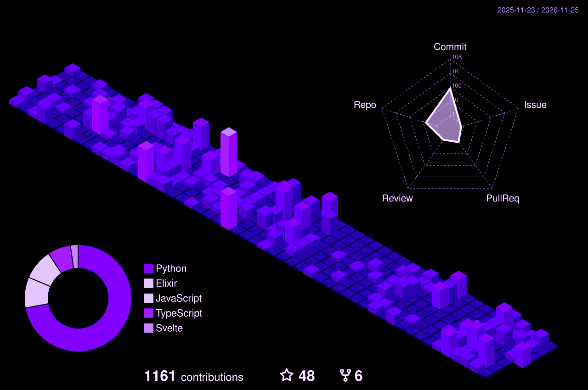

<!-- profile readme v4 @ purple era — assets/ ships with this file -->

  

  

### *own your systems, don't rent them.*
**Infrastructure you control, audit, and scale.**

  

I help businesses move from <b>duct-taped SaaS stacks</b> to <b>custom-owned infrastructure</b> — 
<b>Production systems, not demos.</b> Private AI stacks that never leave your infrastructure.

---

### ⚙ what I build

| | |
|:--:|:--|
| ◈ | **AI agent automation frameworks** with production-grade orchestration |
| ◈ | **MCP-driven platforms** connecting LLMs to real tools and data |
| ◈ | **Multi-agent systems** with failover logic, memory, and human-in-the-loop |
| ◈ | **Private AI stacks** that never leave your infrastructure |

---

<!-- ─────────── research hero ─────────── -->

### ◆ published research — the Abliterator

**refusal lives in a ~5-dim subspace per layer** · PCA projection at s=1.0 → **5% refusal / 0% degeneration / 95% true compliance @ ppl 13.18** · jailbreak attack refusal **82%→11%** · 15+ experiments incl. 4 negative results

[oso-obliterated-models](https://github.com/OSOSerious/oso-obliterated-models-) · [OSO-AI on Hugging Face](https://huggingface.co/OSO-AI)

---

<!-- ─────────── languages — ELIXIR FIRST ─────────── -->

### ▸ languages — Elixir first

| Language | Proficiency | Use Cases |
|:---------|:------------|:----------|
| **Elixir** |  | **The first language.** Distributed systems, Phoenix LiveView, fault-tolerant architectures, event-driven backends, OTP supervision — the shape of everything else I build |
| **Python** |  | AI/ML, FastAPI/Django/Flask, automation, TensorFlow/PyTorch, Celery, data processing |
| **TypeScript** |  | Full-stack web dev, Node.js backends, React/Next.js, enterprise applications |
| **JavaScript** |  | Frontend development, Node.js, browser automation, scripting |
| **GraphQL** |  | Schema design, resolvers, subscriptions, Apollo Server/Client, Hasura |
| **SQL** |  | PostgreSQL (CTEs, window functions, JSONB), MySQL, query optimization, schema design |
| **Bash** |  | Scripting, automation, DevOps pipelines, CI/CD workflows |
| **Go** |  | High-performance backends, CLI tools, microservices. Projects: deep-wiki, osa-main |
| **Svelte** |  | Frontend apps, SvelteKit. Projects: cyber_agents, svelte-map |
| **Rust** |  | Systems programming, performance-critical components, WebAssembly |

---

### ▸ frameworks

<b>▸ detailed experience — frameworks & backend</b>

| Framework | Detailed Experience |
|:----------|:--------------------|
| 🔷 **Phoenix (Elixir)** | LiveView real-time UI, Channels for WebSockets, Ecto ORM, fault-tolerant architecture — my default for systems that must not fall over |
| 🔷 **LangGraph 1.0** | Graph-based agent orchestration with state management, checkpointing for long-running workflows, LangGraph Studio for visual debugging, human-in-the-loop interrupts, conditional branching, parallel execution, production deployment patterns. |
| 🔷 **CrewAI** | Role-based multi-agent team orchestration with hierarchical process management, custom tool integration, agent delegation patterns, memory sharing between agents, production deployment of collaborative agent systems. |
| 🔷 **OpenAI Agents SDK** | Agent handoffs, built-in guardrails, native tool calling with structured outputs, tracing and observability, conversation management, GPT-5/o3/o4 model integration. |
| 🔷 **AutoGen / AG2** | Microsoft's multi-agent conversation framework (AutoGen 2.0/AG2), Semantic Kernel integration, conversational agents with code execution, group chat orchestration, enterprise deployment patterns. |
| 🔷 **Google ADK** | Google Agent Development Kit, Vertex AI Agent Engine integration, GCP-native deployment, BigQuery and Cloud Storage tool access, enterprise-scale agent systems. |
| 🔷 **MCP Protocol** | Model Context Protocol server development, custom tool integration, resource management, A2A interoperability, MCP server for Browserbase, production MCP deployments. |
| 🔷 **LangChain** | Chains, agents, memory systems, document loaders, retrievers, LangSmith observability, LCEL expression language. |
| 🔷 **LlamaIndex** | RAG-first framework: query engines, data connectors, index optimization, enterprise retrieval, hybrid search. |
| 🔷 **Swarm (OpenAI)** | Lightweight multi-agent handoffs, context variable passing, function-based agent transitions. |
| 🔷 **Flowise / Dify** | Low-code LLM flow builders, custom node development, API deployment, rapid prototyping. |
| 🔷 **Claude Code** | AI-powered development, MCP server development, agent automation, codebase analysis, multi-file code generation. |
| 🔷 **Custom Agent Harnesses** | Built agent runtimes from scratch — event-driven loops, multi-provider routing, plan-as-DAG execution (one mutation per node), persistent memory with confidence decay, checkpoint/restore, and embedded object storage. |
| 🔷 **FastAPI / Django / Flask** | High-performance Python APIs, async/await, OpenAPI, Pydantic; Django REST + Celery; lightweight Blueprints. |
| 🔷 **Express / Next.js / NestJS** | Node.js APIs and middleware; full-stack React with App Router/Server Components; enterprise DI + GraphQL. |
| 🔷 **SvelteKit / gRPC** | Server routes, form actions, adapter deployment; protobuf service definition, bidirectional streaming. |

<b>▸ models & providers</b>

| Provider | Models & Experience |
|:---------|:--------------------|
| ⚡ **OpenAI** | GPT-5 flagship, GPT-4o multimodal, o3-pro/o4-mini reasoning, Agents SDK, Assistants API, Codex, embeddings (text-embedding-3-large), Whisper, DALL-E 3 |
| ⚡ **Anthropic** | Claude 4.5 (Opus/Sonnet), extended thinking, tool use, prompt caching (90% cost ↓), batch processing, MCP server development |
| ⚡ **Google** | Gemini 2.5 Pro/Flash, Vertex AI Agent Engine, AI Studio, grounding with Google Search |
| ⚡ **DeepSeek** | DeepSeek-V3.1 (671B MoE), R1 reasoning (MIT license), R1-Distill variants |
| ⚡ **Alibaba (Qwen)** | Qwen 3 (235B MoE), Qwen 2.5 Coder 32B, Qwen-Math, Qwen-VL |
| ⚡ **Zhipu (GLM)** | GLM-5.x family for agentic coding — flash/full tier routing, cost/performance tuning |
| ⚡ **Groq** | LPU-accelerated inference, ultra-fast token generation, consistent low latency |
| ⚡ **Self-Hosted** | Ollama, vLLM (prefix-cache economics), LiteLLM, NVIDIA Triton, TGI, llama.cpp — data never leaves your infra |

---

### 

  

---

### 

<b>▸ databases & vector stores</b>

| Database | Experience |
|:---------|:-----------|
| **PostgreSQL** | Primary DB, CTEs, window functions, JSONB, full-text search, pgvector for embeddings, replication |
| **Redis** | In-memory store, caching, pub/sub messaging, streams, session storage, rate limiting |
| **MongoDB** | Document database, aggregation pipelines, Atlas cloud deployment |
| **Supabase** | Postgres + Auth + Storage + Realtime, Row Level Security, edge functions |
| **Neon** | Serverless Postgres, branching, autoscaling |
| **Qdrant / Pinecone** | Vector databases for semantic search, hybrid search, production RAG |
| **ChromaDB / FAISS** | Local vector stores; billion-scale similarity search |
| **Elasticsearch** | Full-text search, analytics, log aggregation, vector search |

---

### 

<b>▸ queues, automation, cloud, observability</b>

**Queues & events:** Redis Pub/Sub (inter-agent communication at The Swarms Corporation) · Redis Streams (consumer groups, exactly-once) · Apache Kafka · RabbitMQ · Celery/Celery Beat · BullMQ · AWS SQS (FIFO, DLQ)

**Automation & orchestration:** n8n production workflows + custom TypeScript nodes · Temporal durable workflows, sagas · Apache Airflow DAGs · Playwright / Puppeteer browser automation · Browserbase MCP server

**Cloud & DevOps:** Docker multi-stage · Kubernetes/Helm · Terraform IaC · AWS (EC2, S3, Lambda, ECS, RDS, SQS, API Gateway, CloudFront, IAM) · GCP (Cloud Run, BigQuery, Vertex AI) · Vercel Edge · Cloudflare (Workers, R2, D1) · GitHub Actions CI/CD

**Observability:** LangSmith · Langfuse self-hosted · Prometheus · Grafana/Loki · Datadog · Sentry · OpenTelemetry

---

<b>▸ AI/ML infra · security · testing</b>

**AI/ML:** Hugging Face · NVIDIA Triton · vLLM · ONNX · scikit-learn · TensorFlow · PyTorch

**Security:** OAuth 2.0 · JWT · HashiCorp Vault · SSL/TLS · API keys

**Testing:** Pytest · Jest · Vitest · Playwright · Cypress · k6

---

### 

---

### 

<b>▸ integration & operations</b>

| Multi-agent systems (LangGraph/CrewAI) | n8n workflows + LLM integrations | API design & documentation |
|:--|:--|:--|
| Tool calling with structured outputs | Custom n8n node development | Webhooks & event handling |
| MCP Protocol integration | API orchestration and chaining | Data synchronization patterns |
| Persistent memory (Qdrant, Pinecone) | Event-driven architecture | Stripe, Google, Slack, CRMs |
| Human-in-the-loop approval | Background job processing | Migration planning |
| GPT-5, Claude 4.5, Llama 4 support | Webhook management | Legacy system integration |
| **Cost-controlled LLM usage** | **Local/VPC (Ollama, vLLM, LiteLLM)** | **Technical documentation** |
| **Prompt caching (90% cost ↓)** | **Data never leaves your infra** | **Knowledge base creation** |
| **Hybrid model routing** | **Open source model deployment** | **Onboarding materials** |
| **Token optimization** | **Compliance-ready architecture** | **Team training sessions** |
| **LangSmith/Langfuse observability** | **Audit trail logging** | **Video walkthroughs** |
| **Performance benchmarking** | **GDPR/HIPAA considerations** | **Ongoing support options** |

---

### ▸ featured work

---

<!-- ─────────── the year, as a city ─────────── -->

### ◆ the year as a skyline

---

  

  

*I don't build demos — I build production systems.*

