<!-- profile readme v5 @ full purple — all 44 SVG assets, all sections open, nothing from v3 dropped -->

  

  

### *own your systems, don't rent them.*
**Infrastructure you control, audit, and scale.**

  

 

---

# ◆ EVERYTHING, AS ONE OBJECT — 3D

**The stack, as a solid thing:** six faces — *elixir · agents · data · infra · sec · ship* — rotating in real 3D (true orthographic projection, depth-shaded violet faces, backfaces culled frame-by-frame, shadow breathing underneath). 36 keyframes per face, pure SVG — no JS, no canvas.

**And the whole README as one map:** every section below is an extruded isometric tile, numbered in reading order — a light signal walks the path from `01 RESEARCH` through `10 DELIVER`, each tile flaring as it arrives. This page, modeled as a place.

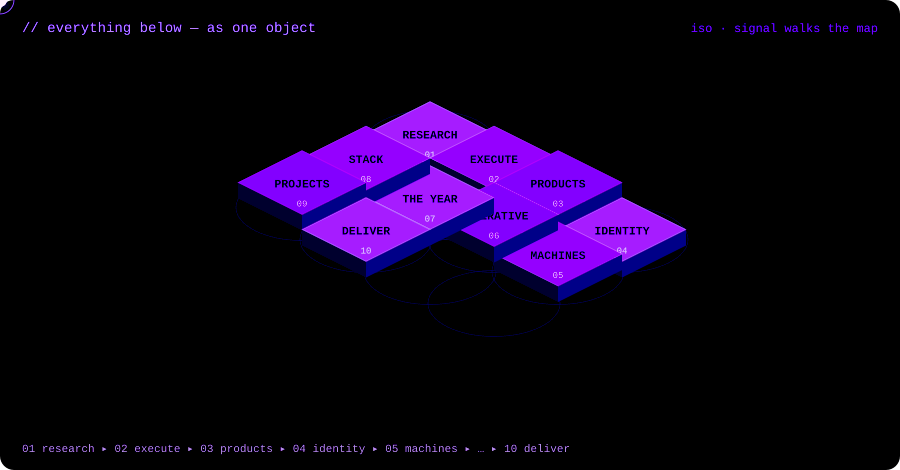

**And the mark itself, in blocks:** OSO rebuilt from **47 extruded cubes** — front/top/right faces, painter-sorted so depth reads true — popping in column by column, straight into the shadow beneath.

**And the product itself, stacked:** five isometric layers — `DATA ▸ STATE ▸ AGENTS ▸ TOOLS ▸ SURFACE` — floating as one tower, each plate only touching the one below, with energy pulses climbing bottom to top. The architecture, as an object you could pick up.

---

# ◆ THE WORK, ANIMATED — all of it

Every graphic below is **my own pure-SVG animation** living in this repo's `assets/` — no screenshots, no stock art, no external images for the animation layer. Each one is labeled with what it actually shows.

### ▸ RESEARCH — the Abliterator (published)

**What it shows:** five layer planes of Qwen2.5-1.5B, the bright **Δ(refusal)** vector, and the dashed **PCA basis (k=5) projecting it out at s=1.0** — HUD: **82%→5% refusal · 95% true compliance · 0% degeneration · ppl 13.18 · jailbreaks 82%→11%**. The real finding: *refusal lives in a ~5-dim subspace per layer* — [oso-obliterated-models](https://github.com/OSOSerious/oso-obliterated-models-) · [OSO-AI on Hugging Face](https://huggingface.co/OSO-AI). 15+ experiments, 4 negative results logged honestly.

### ▸ HOW THE SYSTEMS EXECUTE

**Plan-as-DAG, one mutation per node.** Nodes fire in dependency order, packets stream the edges, `write` sits behind a ✓ verify gate — nothing downstream runs until the gate passes.

**Findings survive, context doesn't.** Left: context compacted to ~10%. Right: findings lit with provenance (`ex:97`, `cli.py:412`) — bug → root-cause → fix-plan wired together.

**The only way data leaves.** `tools/call` out, `result [[LEAD]]` back, everything crosses the **anonymize gate at egress** — names become tokens before the server. The model never writes the sent text.

**Inventory by truth, not by claim.** A box rides the belt through XR-1; the screen reveals its skeleton — `db:5432`, `q:rabbit` — and stamps **SAFE ✓**.

**The thesis, as a factory line.** Duct-tape SaaS goes in, the OWN-IFIER press slams, identical owned modules come out stacked: db ✓ auth ✓ agents ✓ audit ✓.

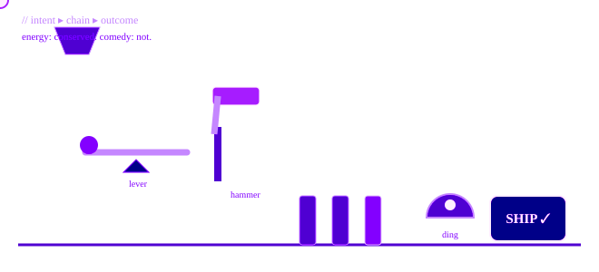

**One intent, chain of steps.** Ball → teeter-totter → hammer → dominoes → bell → **SHIP ✓**. Your execution philosophy told as physical comedy, 7s loop.

### ▸ BUILT FROM THE PRODUCTS

**Goldclaw.ai as an arcade claw.** Cable drops, jaws grab a `[[TOKEN]]` off the lead belt, hauls it to the **SHIP** chute. Flagship loop: grab → process → ship.

**NewsTerminal / AutomateMedia press line.** Split-flap flips `BREAKING ▸ ANGLE ▸ SHIPPED (2:58 < 3:00)`, wire marquee runs the real content rules, REC dot pulses.

**Voiceprints.ai.** 22 breathing waveform bars, scan line sweeps, shackle clicks open on **MATCH ✓** — your voice is the key.


**Data never leaves your infrastructure.** Fans spin, drive LEDs blink in I/O rhythm, packets pulse down patch cables, LCD reads `gdpr: audit ON`.


**ROUTER-9000 — hybrid routing as a DJ desk.** Faders for GPT-5/CLAUDE/LOCAL ride themselves on SLA, VU meters bounce, cache LED reads **−90%**, master gauge: `0.31 → 0.04 $/1k tok`.

**Espresso pulls = pushes.** Press, portafilter fills, stream pulls into a cup labeled `main`, "shots today" ticks. Every deploy starts the same way.

### ▸ IDENTITY — proofs of the mark


**Self-drawing blueprint.** A plotter draws OSO with construction circles, then stamps the dimensions: `180° palindrome · favicon 16px · NO GRADIENT · DWG OSO-001 REV 5`.

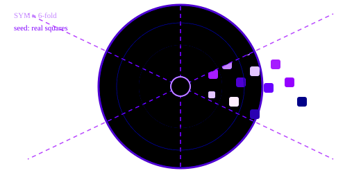

**Symmetry generated, not drawn.** Three mirror wedges rotate against a seed of your real contribution squares — infinite violet symmetry from finite work.

**The palindrome, literal.** Your graph mirrored into an inkblot that breathes and flips through 180° — indistinguishable upside-down, because that IS the brand.

**The beacon.** OSO in Morse — `—··· ··· —···` — symmetric in that alphabet too. The palindrome holds everywhere.

**The seal.** A stamp presses OSO into violet wax over `signed-off-by` — provenance you can feel, same rule as the findings graph.


**The projection.** The mark as a flickering hologram — identity that only exists while the system is powered.

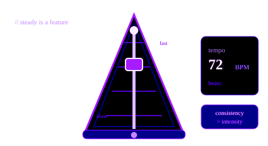

**The tempo.** 72 BPM, <i>consistency &gt; intensity</i> — how the shipping actually works: parallel threads, one steady beat.

**The convergence tick.** Your report ritual as HUD: pips fill, `[4] → [5]`, bar sweeps. Converge · report · repeat.

### ▸ MACHINES — the physics of the pipeline

**Failover as pinball.** The SHIP ball ricochets bumpers (`mcp · memory · harness`), flippers fire as retries, drain is **▼DEADLINE▼** — the ball never dies, it reroutes.


**Probability as hardware.** A token drops through SLA pins into `LOCAL / BALANCED / FRONTIER` buckets; cost meter flips `0.31 → 0.04`.


**One push, full cascade.** probe → plan → mutate → test → lint → build fall in sequence, last reveal **SHIP ✓**. "Deps = gravity."


**Merge discipline.** The marble waits at gates that only swing when `test ✓` and `review ✓` pass, then rolls into the **merged** bin.


**Observability as weather.** The beam sweeps 360° through fog; your fleet's ships flip green → amber → green as light passes. `uptime 99.97`.


**Deploy ritual.** Split-flap digits 10…3…2, **LIFTOFF**, rocket rises past the checklist: `✓ 3252/3252 ✓ rollback staged ▸ canary 5%`.

**Jackpot logic.** Reels snap S·H·I·P, bell flashes, counters read `3,252 tests ✓ 0f` and commits ticking 240 → 242. Retro chrome, one Signal lever.

**The execution loop, as a building.** Car rides `PLAN → ACT → VERIFY → REMEMBER → SHIP`, doors hold at VERIFY — one floor per gate.


**Discovery through search.** Wrong turns dim, dead-ends re-route, the winning path locks in violet behind the token. Recon instinct, tiny game.

**The real session.** Vacuum eats the cache piles (lima · mix · go · brew), free-space gauge climbs `57GB → 128GB`, log reads: **no rm. moved. logged.**

### ▸ GENERATIVE — running on their own rules


**Goo-filter metaballs.** `feGaussianBlur → feColorMatrix` makes five violet blobs — your five languages — fuse and split into one organism. Zero JS.

**Conway B3/S23 on your squares.** A glider crosses, a blinker rotates, a pulsar breathes — emergence from simple rules, your agent thesis in motion.


**The genome of shipping.** Two strands path-morphing through each other, base-pair rungs lighting in sequence, codon scanner sweeping. Code as life.


**Your cadence as test equipment.** CRT waveform morphs calm → burst → spike (push days), glowing scan dot on the graticule: `TRIG ▸ AUTO · SIG: prod`.


**The constellation.** Repos on elliptical SMIL orbits around the OSO core — `harness · memory · mcp-tools · abliterate · erp · agents` — periods staggered so it never repeats the same way twice.


**Swarm with no single point.** Scouts fly a real waggle-dance figure-8, hex cells fill with `[[TOKENS]]`, the queen cell pulses as orchestrator.

**The koi, rebuilt.** A fish whose body IS your contribution squares, iso-shaded like the city — tail flicks, ripples. Your data, alive.

### ▸ THE YEAR

**What it shows:** *my actual* contribution graph — regenerated from **my own account** (`year-city` workflow, run on demand): every building is a day of my real work, towers rise on load, radar sweeps the blocks. Violet depth ramp, zero green.

**The ribbon** below counts the same year for real: **1,162 contributions · 157 active days · 53 weeks**, violet heat `1 ▸ 3 ▸ 6 ▸ 10+`, today's cell pulses, light band sweeps every 6s.


---

## ◆ languages — Elixir first

     


---

## ◆ frameworks — Phoenix first

### agent frameworks

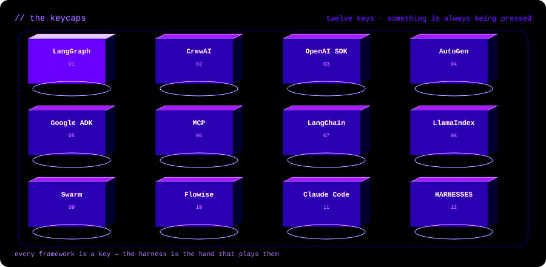

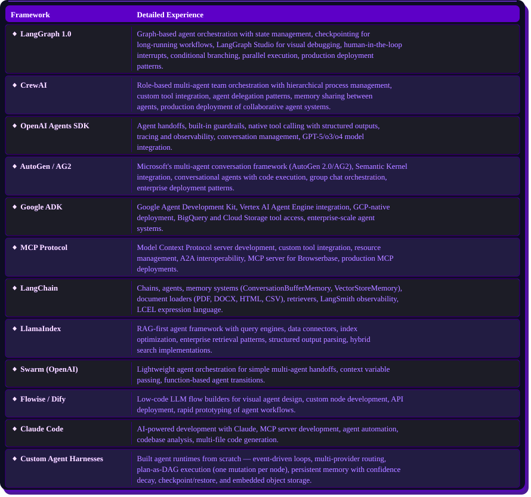

---

## ◆ models & providers

---

## ◆ databases & vector stores

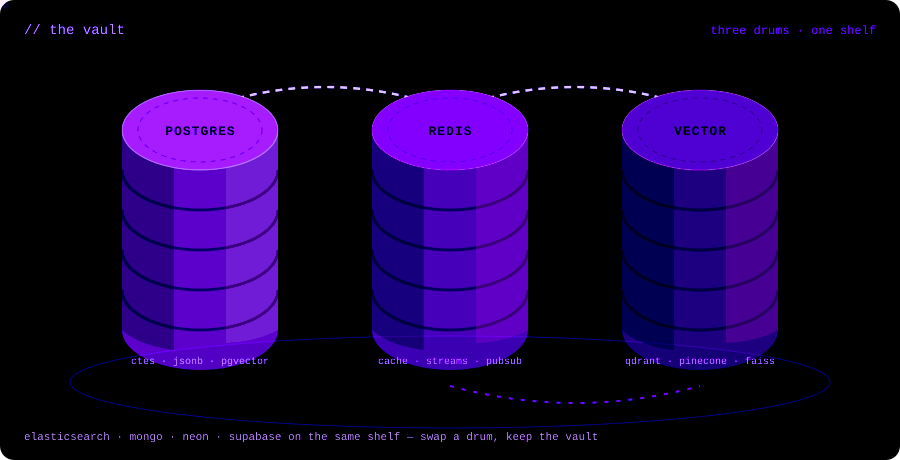

---

## ◆ message queues & events

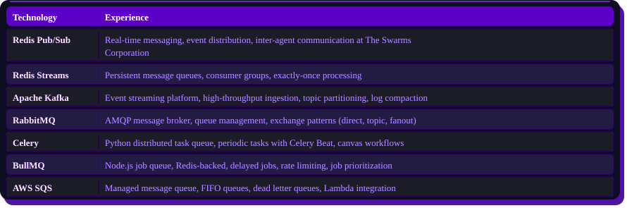

---

## ◆ automation & orchestration

---

## ◆ cloud & devops

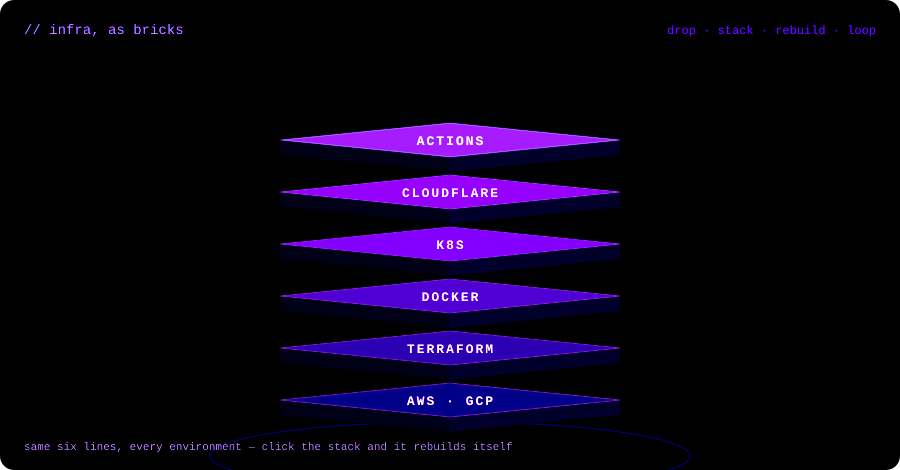

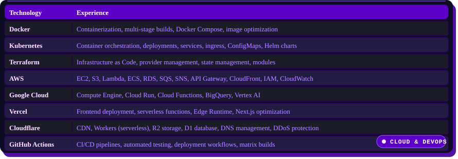

---

## ◆ observability, monitoring & security

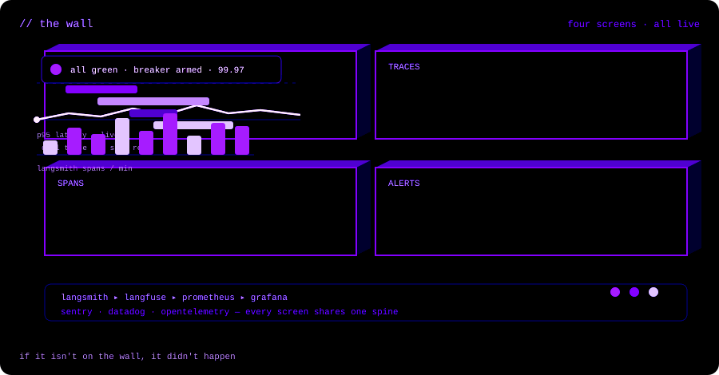

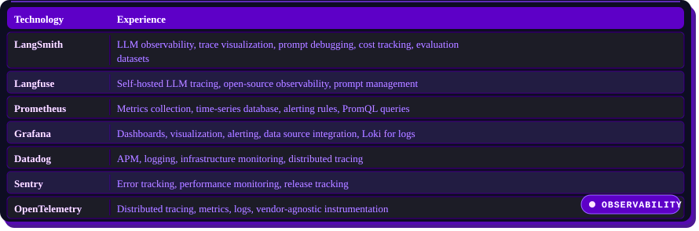

**Security:** OAuth 2.0 · JWT · HashiCorp Vault · SSL/TLS · API Keys

**Testing:** Pytest · Jest · Vitest · Playwright · Cypress · k6

**AI/ML infra:** Hugging Face · NVIDIA Triton · vLLM · ONNX · scikit-learn · TensorFlow · PyTorch

---

## ◆ API integrations

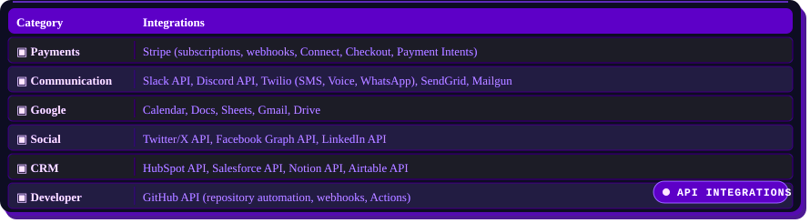

---

## ◆ featured projects — award-winning · open source · production-ready


### ◈ AI Agent & Automation Projects

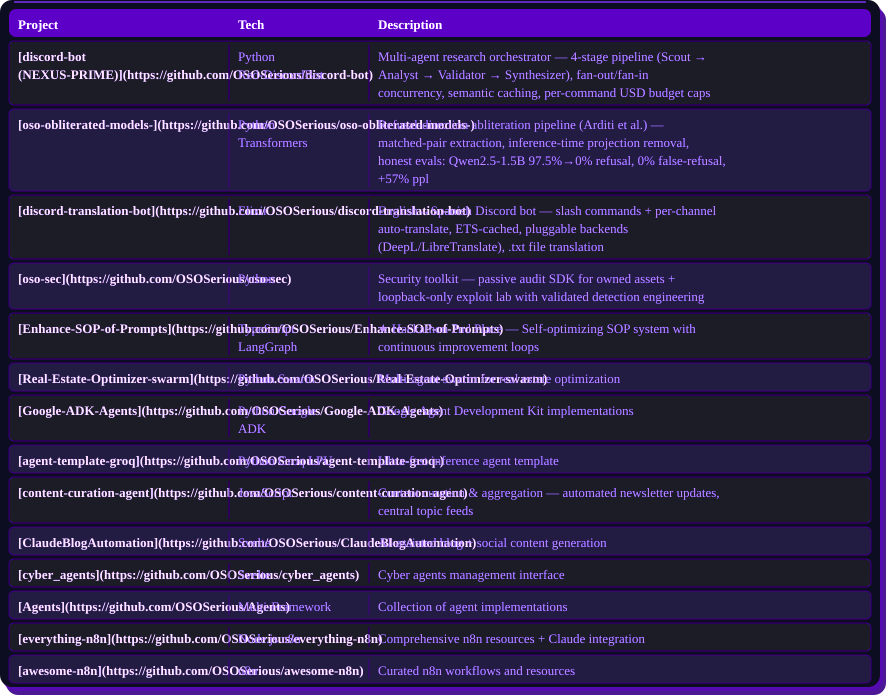

### ◈ Full-Stack & Backend Projects

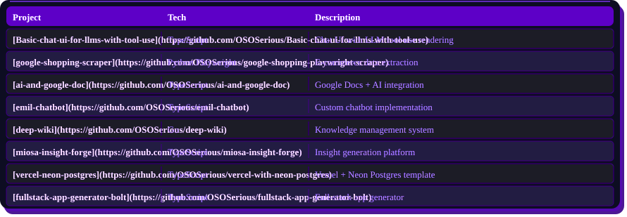

### ◈ Frontend & Developer Resources

---

## ◆ what I deliver — production systems designed for agencies to deploy to clients

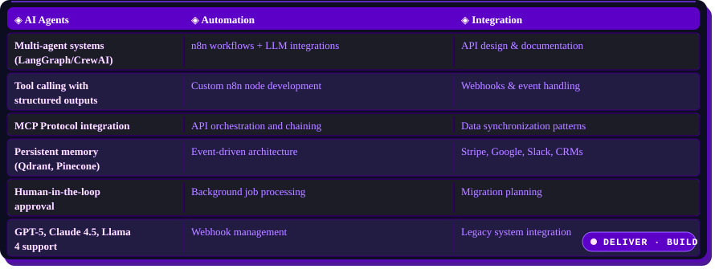

---

## ◆ github stats

  
  

 

  

<!-- activity graph removed: public instance returning 402 for this account -->

---

  

 

  

 

  

  <i>No more renting disconnected software. I build infrastructure where you own the code and data, you control the deployment, you can audit every workflow, you can extend and customize freely, and you're not locked into vendor pricing.</i>

 

  <picture>
    <source media="(prefers-color-scheme: dark)" srcset="https://raw.githubusercontent.com/OSOSerious/OSOSerious/output/github-snake-dark.svg">
    <source media="(prefers-color-scheme: light)" srcset="https://raw.githubusercontent.com/OSOSerious/OSOSerious/output/github-snake.svg">
    
  </picture>
   
  

 

  

*I don't build demos — I build production systems.*

   

  

