<!-- profile readme v6 @ purple era + 3D — 64 assets, every figure teaches, all sections open -->

  

  

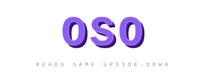

### *own your systems, don't rent them.*
**Infrastructure you control, audit, and scale.**

  

 

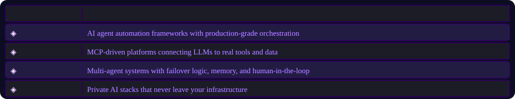

---

# ◆ EVERYTHING, AS ONE OBJECT — 3D

**The stack, as a solid thing:** six faces — *elixir · agents · data · infra · sec · ship* — rotating in real 3D (true orthographic projection, depth-shaded violet faces, backfaces culled frame-by-frame, shadow breathing underneath). 36 keyframes per face, pure SVG — no JS, no canvas.

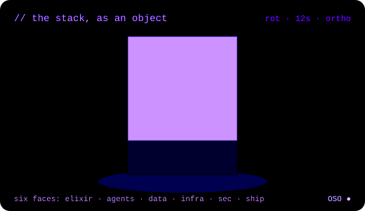

**Why a cube:** six faces, one object — the stack is only '3D' when every side holds: elixir, agents, data, infra, security, ship. Rotating it is how I check none of the faces is missing.

**And the whole README as one map:** every section below is an extruded isometric tile, numbered in reading order — a light signal walks the path from `01 RESEARCH` through `10 DELIVER`, each tile flaring as it arrives. This page, modeled as a place.

**The map lesson:** a README is a *place*. Numbered tiles, one path, a signal that walks it — because systems should be walkable. If you can't trace the route, you don't own the system yet.

**And the mark itself, in blocks:** OSO rebuilt from **47 extruded cubes** — front/top/right faces, painter-sorted so depth reads true — popping in column by column, straight into the shadow beneath.


**OSO in blocks:** the palindrome rebuilt from 47 cubes — same from either direction because every block is placed twice as strong. Small honest units, stacked, read as a whole.

**And the product itself, stacked:** five isometric layers — `DATA ▸ STATE ▸ AGENTS ▸ TOOLS ▸ SURFACE` — floating as one tower, each plate only touching the one below, with energy pulses climbing bottom to top. The architecture, as an object you could pick up.

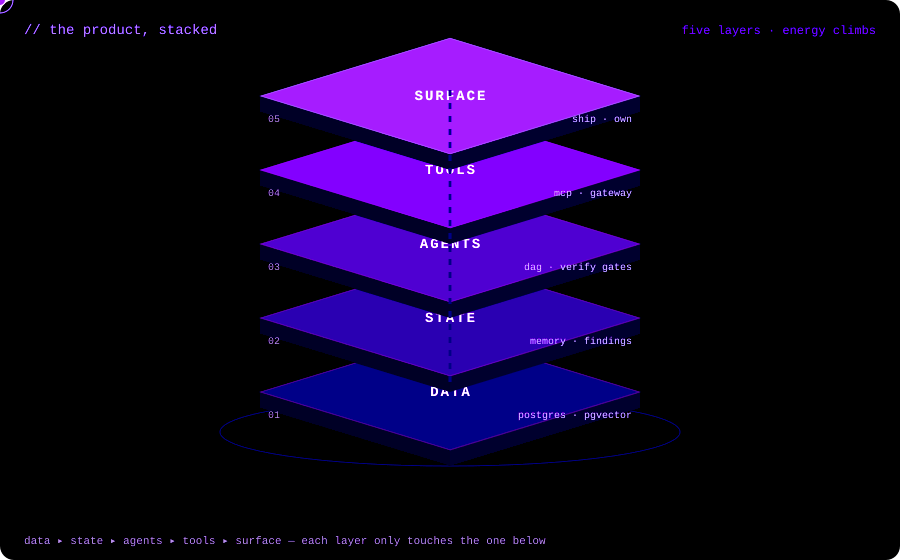

**The layer rule:** each plate only touches the one below — data → state → agents → tools → surface. Skip a layer and the tower wobbles; that's how platforms rot. Energy climbs, dependencies don't.

---

# ◆ THE WORK, ANIMATED — all of it

Every graphic below is **my own pure-SVG animation** living in this repo's `assets/` — no screenshots, no stock art, no external images for the animation layer. Each one is labeled with what it actually shows — and what it *teaches*.

### ▸ RESEARCH — the Abliterator (published)

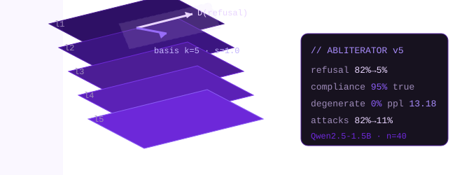

**What it shows:** five layer planes of Qwen2.5-1.5B, the bright **Δ(refusal)** vector, and the dashed **PCA basis (k=5) projecting it out at s=1.0** — HUD: **82%→5% refusal · 95% true compliance · 0% degeneration · ppl 13.18 · jailbreaks 82%→11%**. The real finding: *refusal lives in a ~5-dim subspace per layer* — [oso-obliterated-models](https://github.com/OSOSerious/oso-obliterated-models-) · [OSO-AI on Hugging Face](https://huggingface.co/OSO-AI). 15+ experiments, 4 negative results logged honestly.

### ▸ HOW THE SYSTEMS EXECUTE

**The rule behind the gate:** verification isn't a step in the work — it's a *wall* the work has to get past. One mutation per node means a failure has exactly one address. Debugging is boring on purpose here; boring is the feature.

**Plan-as-DAG, one mutation per node.** Nodes fire in dependency order, packets stream the edges, `write` sits behind a ✓ verify gate — nothing downstream runs until the gate passes.


**The teaching:** context *must* be thrown away — that's what compaction is — but lessons shouldn't be. Findings carry their file:line so a future session starts wise instead of starting over. Forgetting on purpose, remembering on purpose.

**Findings survive, context doesn't.** Left: context compacted to ~10%. Right: findings lit with provenance (`ex:97`, `cli.py:412`) — bug → root-cause → fix-plan wired together.

**The security lesson:** safety is a *door*, not a wall. Everything still flows — it just can't flow raw: names become `[[TOKENS]]` before egress, the model never writes what gets sent, every hop leaves an audit row. Useful and safe at the same time, or it isn't shipped.

**The only way data leaves.** `tools/call` out, `result [[LEAD]]` back, everything crosses the **anonymize gate at egress** — names become tokens before the server. The model never writes the sent text.

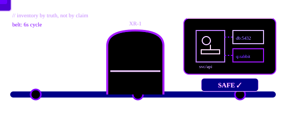

**Why scan first:** every migration starts with a lie — *we know our systems*. The scanner replaces claims with structure: you can't secure, cost, or re-architect what you haven't actually looked inside of.

**Inventory by truth, not by claim.** A box rides the belt through XR-1; the screen reveals its skeleton — `db:5432`, `q:rabbit` — and stamps **SAFE ✓**.

**The economic lesson:** rent is fine until the renter changes the price. The press takes duct-taped SaaS and stamps out modules you hold the deed to — db, auth, agents, audit. That's the whole business, one machine wide.

**The thesis, as a factory line.** Duct-tape SaaS goes in, the OWN-IFIER press slams, identical owned modules come out stacked: db ✓ auth ✓ agents ✓ audit ✓.

**The joke is the point:** complex pipelines *should* look silly drawn out — ball, seesaw, hammer, dominoes, bell. If your automation can't be told as a story with five stages, you don't understand it well enough to trust it.

**One intent, chain of steps.** Ball → teeter-totter → hammer → dominoes → bell → **SHIP ✓**. Your execution philosophy told as physical comedy, 7s loop.

### ▸ BUILT FROM THE PRODUCTS

**The flagship loop:** grab → process → ship, over and over — ERP work is not one big brain, it's a reliable claw. The lesson: boring repetition, done with grip and audit, is what *AI-powered business* actually looks like underneath.

**Goldclaw.ai as an arcade claw.** Cable drops, jaws grab a `[[TOKEN]]` off the lead belt, hauls it to the **SHIP** chute. Flagship loop: grab → process → ship.

**Content rules learned the hard way:** angle beats the raw news (a denial outperforms an announcement 6:1), story collisions beat single facts, speed is the whole pipeline — 2:58 to publish, under the 3:00 line. The ticker runs the rules I actually use.

**NewsTerminal / AutomateMedia press line.** Split-flap flips `BREAKING ▸ ANGLE ▸ SHIPPED (2:58 < 3:00)`, wire marquee runs the real content rules, REC dot pulses.


**The identity lesson:** a password proves you *know* something; a voiceprint proves you *are* something — and it expires the moment it's copied wrong. Liveness check + match threshold, or it's just theater with a waveform.

**Voiceprints.ai.** 22 breathing waveform bars, scan line sweeps, shackle clicks open on **MATCH ✓** — your voice is the key.

**Placement is policy:** *data never leaves your infrastructure* isn't a promise in a privacy policy — it's a rack with no route to the outside. Compliance you can *point at* beats compliance you can only claim.

**Data never leaves your infrastructure.** Fans spin, drive LEDs blink in I/O rhythm, packets pulse down patch cables, LCD reads `gdpr: audit ON`.

**The 80/20 of model cost:** the cheap channel handles the routine, the frontier channel gets called only when the cheap one shrugs — and caching kills 90% of the repeat spend before any model is called at all. Faders, not forks.

**ROUTER-9000 — hybrid routing as a DJ desk.** Faders for GPT-5/CLAUDE/LOCAL ride themselves on SLA, VU meters bounce, cache LED reads **−90%**, master gauge: `0.31 → 0.04 $/1k tok`.

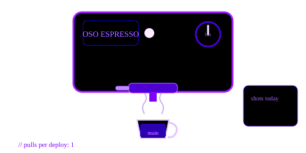

**Ritual as deploy anchor:** the pull, the steam, the shots-ticker — every serious system I've worked on had one absurdly consistent ritual. It marks the boundary between *thinking about it* and *it's in production*.

**Espresso pulls = pushes.** Press, portafilter fills, stream pulls into a cup labeled `main`, "shots today" ticks. Every deploy starts the same way.

### ▸ IDENTITY — proofs of the mark

**Constraints first, pixels second:** draw the thing before you style it — 180° palindrome, favicon-legible at 16px, flat fill, no gradients. A mark that survives those constraints survives every medium it lands in.

**Self-drawing blueprint.** A plotter draws OSO with construction circles, then stamps the dimensions: `180° palindrome · favicon 16px · NO GRADIENT · DWG OSO-001 REV 5`.

**Symmetry you can trust:** rotate real data through mirrors and it *generates* beauty without lying — every petal still traces back to a real day. That's the design brief for this whole page: pretty, but provable.

**Symmetry generated, not drawn.** Three mirror wedges rotate against a seed of your real contribution squares — infinite violet symmetry from finite work.


**The test of a mark:** inkblots show you what you bring — this one shows the same thing both ways up. If a symbol survives being mirrored, flipped, and shrunk, it stops being a logo and becomes a stamp.

**The palindrome, literal.** Your graph mirrored into an inkblot that breathes and flips through 180° — indistinguishable upside-down, because that IS the brand.


**The palindrome holds everywhere:** OSO reads the same flipped — and Morse (`—··· ··· —···`) proves it isn't a Latin-script trick. Test your brand in the oldest alphabet you can find; if it survives that, it survives anything.

**The beacon.** OSO in Morse — `—··· ··· —···` — symmetric in that alphabet too. The palindrome holds everywhere.


**Provenance you can feel:** a stamp doesn't stop tampering by force — it makes tampering *visible*. Same as signed commits and audit rows: the goal isn't to prevent, it's to make every touch leave a mark.

**The seal.** A stamp presses OSO into violet wax over `signed-off-by` — provenance you can feel, same rule as the findings graph.

**The sober version of cool:** identity that only exists while the system is powered is also identity that dies with the power. Holograms are the aesthetic — the engineering underneath is still keys, rotation, and revocation.

**The projection.** The mark as a flickering hologram — identity that only exists while the system is powered.

**Tempo over sprints:** 72 BPM — a working pace you can hold for years. Big-bang weeks produce big-bang reverts; a metronome produces 1,162 contributions. Consistency compounds, intensity just burns.

**The tempo.** 72 BPM, <i>consistency &gt; intensity</i> — how the shipping actually works: parallel threads, one steady beat.


**The feedback loop:** pips fill, count rolls, bar sweeps — converge, report, repeat. The lesson: a ritual you can *see* (4/5, then 5/5) turns vague progress into a signal both you and your partner trust.

**The convergence tick.** Your report ritual as HUD: pips fill, `[4] → [5]`, bar sweeps. Converge · report · repeat.

### ▸ MACHINES — the physics of the pipeline


**Failover is not the same as no failure:** the ball *will* drain toward the deadline — the design question is how many bumpers and flippers you've built between there and here. Resilience is measured in ricochets survived.

**Failover as pinball.** The SHIP ball ricochets bumpers (`mcp · memory · harness`), flippers fire as retries, drain is **▼DEADLINE▼** — the ball never dies, it reroutes.

**Bet, don't predict:** routing shouldn't guess which model *feels* right — it should drop the token through SLA pins and let landing decide. Probability with receipts beats intuition with vibes, every time.

**Probability as hardware.** A token drops through SLA pins into `LOCAL / BALANCED / FRONTIER` buckets; cost meter flips `0.31 → 0.04`.

**Dependencies are gravity:** every standing domino is a promise to the next, and the cascade only runs because the order was *designed* first. Plan the fall before you push the first tile.

**One push, full cascade.** probe → plan → mutate → test → lint → build fall in sequence, last reveal **SHIP ✓**. "Deps = gravity."

**Merge discipline.** The marble waits at gates that only swing when `test ✓` and `review ✓` pass, then rolls into the **merged** bin.

**Observability as weather:** you can't steer by a lighthouse you built after the wreck. The beam sweeps whether ships are out or not — monitoring that only runs during incidents is a smoke detector that needs a fire.

**Observability as weather.** The beam sweeps 360° through fog; your fleet's ships flip green → amber → green as light passes. `uptime 99.97`.

**Theater with a checklist:** count downs exist so nobody skips the boring part. Every gate on that list — tests, dry-run migration, staged rollback, canary — is a promise you can keep *because* you said it out loud first.

**Deploy ritual.** Split-flap digits 10…3…2, **LIFTOFF**, rocket rises past the checklist: `✓ 3252/3252 ✓ rollback staged ▸ canary 5%`.


**Luck removal:** a jackpot you can't reproduce isn't engineering. 3,252 tests green before the reels stop is what turns *it works* into *it will keep working* — the only winning move is not leaving it to the spin.

**Jackpot logic.** Reels snap S·H·I·P, bell flashes, counters read `3,252 tests ✓ 0f` and commits ticking 240 → 242. Retro chrome, one Signal lever.


**HITL is a floor, not a bug:** the car holds at VERIFY because a human standing between an agent and production is a *feature of the architecture*. One floor per gate — you can ride down and override, but the doors don't just open.

**The execution loop, as a building.** Car rides `PLAN → ACT → VERIFY → REMEMBER → SHIP`, doors hold at VERIFY — one floor per gate.

**Explore before you exploit:** wrong turns aren't wasted — they're the map being drawn. The locked violet path at the end only exists because the dim ones were walked first.

**Discovery through search.** Wrong turns dim, dead-ends re-route, the winning path locks in violet behind the token. Recon instinct, tiny game.

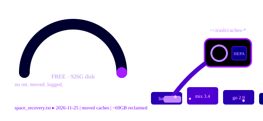

**The housekeeping lesson:** space problems are almost never space problems — they're hygiene. And the real discipline isn't deleting, it's *moving + logging*: every cleanup leaves a receipt (space_recovery.txt) so future-you knows what disappeared and why.

**The real session.** Vacuum eats the cache piles (lima · mix · go · brew), free-space gauge climbs `57GB → 128GB`, log reads: **no rm. moved. logged.**

### ▸ GENERATIVE — running on their own rules

**Fusion, literally:** five languages, one organism — that's what a polyglot stack should feel like when it's wired right. If your services don't merge under load, you built silos with APIs.

**Goo-filter metaballs.** `feGaussianBlur → feColorMatrix` makes five violet blobs — your five languages — fuse and split into one organism. Zero JS.


**Emergence is the whole thesis:** four rules, no leader, and gliders appear — the same way simple agent loops produce behavior nobody wrote. Complexity you can *explain* is complexity you can own; complexity you can't explain is just weather.

**Conway B3/S23 on your squares.** A glider crosses, a blinker rotates, a pulsar breathes — emergence from simple rules, your agent thesis in motion.

**Every system has a genome:** the double helix here is your commit cadence — base pairs lighting in order. Read the rhythm and you can predict the system: steady pairs ship, gaps mutate.

**The genome of shipping.** Two strands path-morphing through each other, base-pair rungs lighting in sequence, codon scanner sweeping. Code as life.

**Measure before you tune:** the waveform says more about shipping health than any standup — bursts are feature weeks, flatlines are burnout or blockers. A cadence you can *see* is a cadence you can defend.

**Your cadence as test equipment.** CRT waveform morphs calm → burst → spike (push days), glowing scan dot on the graticule: `TRIG ▸ AUTO · SIG: prod`.

**Constellation, not monolith:** repos on staggered periods so the sky never repeats — the architecture lesson is independent lifecycles. When everything shares one orbit, one collision takes the whole sky down.

**The constellation.** Repos on elliptical SMIL orbits around the OSO core — `harness · memory · mcp-tools · abliterate · erp · agents` — periods staggered so it never repeats the same way twice.

**No single point:** scouts dance the figure-eight, cells fill with tokens, the queen only *coordinates*. That's multi-agent done right — workers carry the load, the orchestrator carries the map, and any one can die without losing the swarm.

**Swarm with no single point.** Scouts fly a real waggle-dance figure-8, hex cells fill with `[[TOKENS]]`, the queen cell pulses as orchestrator.


**Data as a creature:** the koi's body *is* your contribution squares — the visualization isn't decorating the data, it's wearing it. If you can point at every scale and say which day it was, the picture is honest.

**The koi, rebuilt.** A fish whose body IS your contribution squares, iso-shaded like the city — tail flicks, ripples. Your data, alive.

### ▸ THE YEAR

**The year, honestly:** every building is a real day — no filler, no vanity grid. The teaching: your activity *is* your architecture; build where you want the skyline to grow.

**What it shows:** *my actual* contribution graph — regenerated from **my own account** (`year-city` workflow, run on demand): every building is a day of my real work, towers rise on load, radar sweeps the blocks. Violet depth ramp, zero green.

**The ribbon** below counts the same year for real: **1,162 contributions · 157 active days · 53 weeks**, violet heat `1 ▸ 3 ▸ 6 ▸ 10+`, today's cell pulses, light band sweeps every 6s.

**Read the ribbon like a ledger:** heat = effort, gaps = honest rest. 1,162 contributions over 53 weeks isn't a streak flex — it's proof that systems compound when the loop stays unbroken.

---

## ◆ languages — Elixir first

     

**The lesson in the heights:** depth isn't hype — Elixir leads because it's the language of systems that *don't fall over* (OTP supervision trees, let-it-crash, billions of messages). Python is the muscle for AI/ML, TypeScript the connective tissue. When I architect, Elixir holds the core and the rest plugs in.

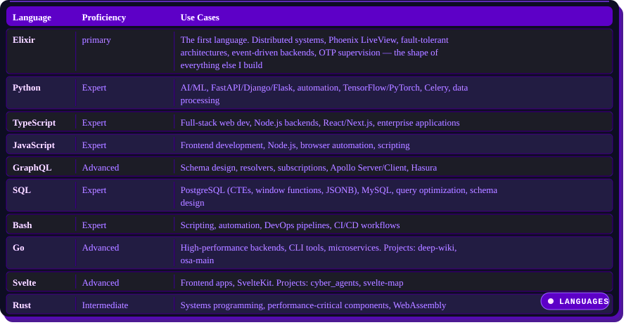

---

## ◆ frameworks — Phoenix first

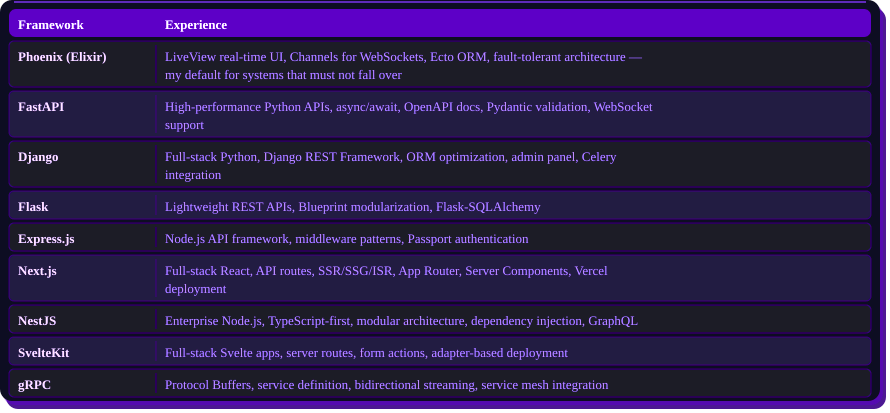

### agent frameworks

**The story:** no single framework wins. *Graph* orchestration (LangGraph) for stateful, checkpointed work; *role* orchestration (CrewAI) for teams of specialists; *handoffs* (Swarm, OpenAI SDK) for lightweight routing; *conversation* (AutoGen) for debating agents; MCP as the universal plug so any of them reach the same tools. The frame below is the desk I play them from.

**How to read it:** a key pressing = that framework taking the job *this cycle*. The rule I teach: **pick the lightest key that can do the work** — Swarm for a two-step handoff, LangGraph when the job must survive a crash mid-workflow, custom harness when neither fits and it has to be exactly right. Twelve tools, one hand.

---

## ◆ models & providers

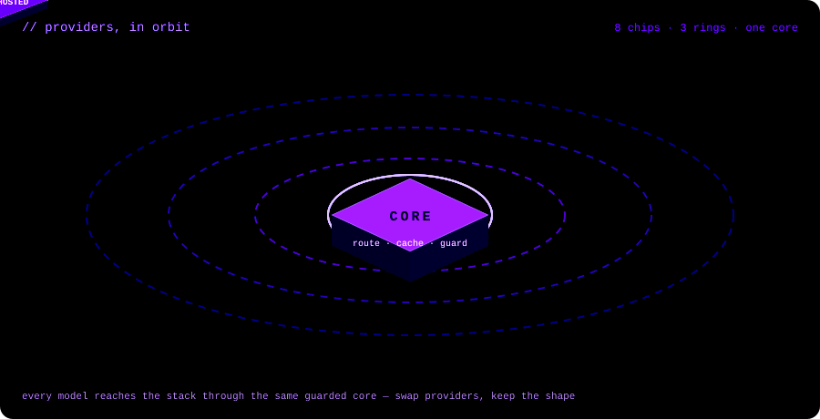

**The story:** every provider here is a commodity — they orbit *my* core, not the other way around. Routing means: cheap model for the easy 80%, frontier for the hard 20%, local when data can't leave the building. Swap a star without moving the system.

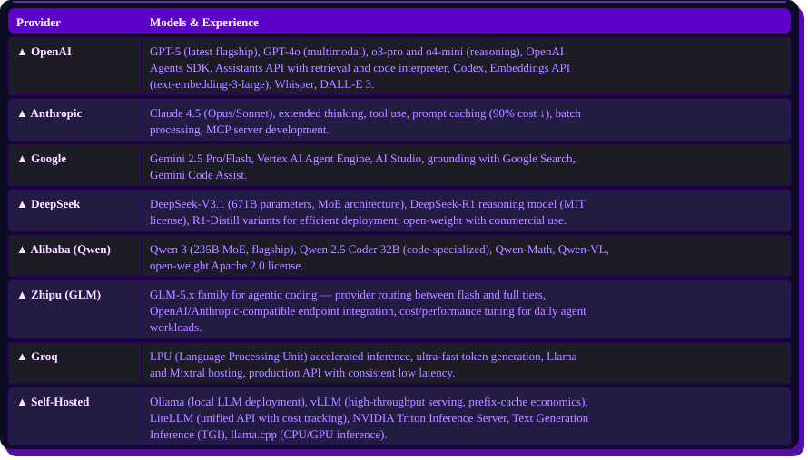

---

## ◆ databases & vector stores

**How the vault works:** Postgres is home (CTEs, JSONB, pgvector — one database that can think), Redis is short-term memory (cache, streams, pub/sub between agents), vector stores give the machines recall. The teaching rule: *data goes in one drum, reads fan out* — never let a second truth exist.

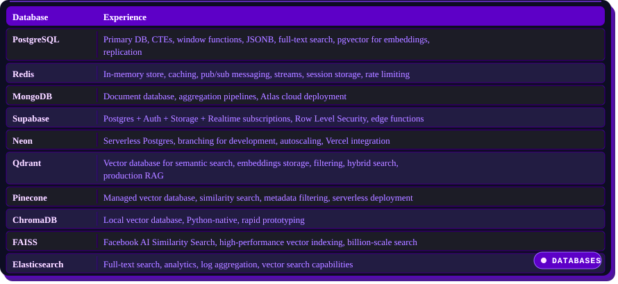

---

## ◆ message queues & events

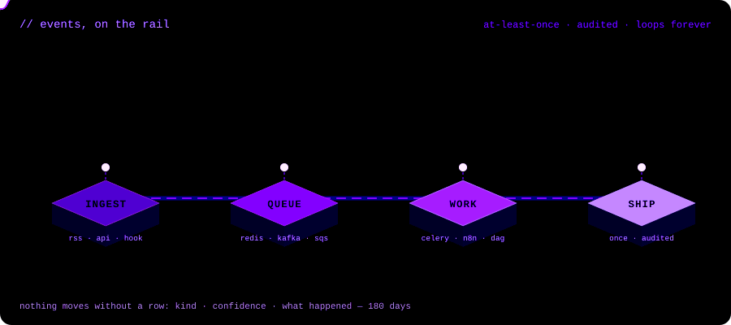

**The story of a message:** something arrives (RSS, API, webhook), waits its turn in the queue, gets worked exactly once, leaves an audit row, ships. Queues are why nothing in my systems is lost when a worker dies mid-job — the packet just finds the next train.

---

## ◆ automation & orchestration

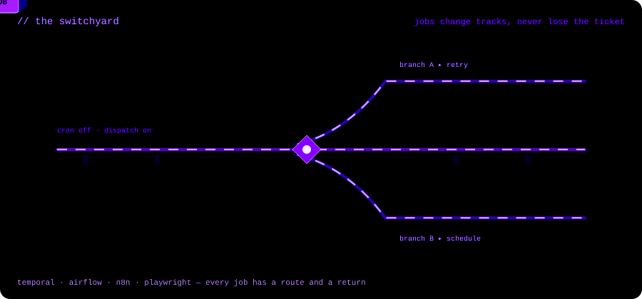

**The lesson:** workflows aren't lines, they're *railways*. A job leaves the main line, hits a junction, and the switch decides — retry A, schedule B — but the ticket (the workflow state) rides with it the whole way. If the locomotive dies, a new one picks up the same rail.

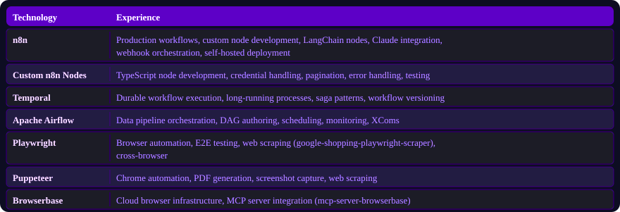

---

## ◆ cloud & devops

**The teaching:** pets vs cattle — servers you hand-fix are pets; bricks you drop from code are cattle. Six lines of Terraform rebuild the whole stack anywhere.

---

## ◆ observability, monitoring & security

**The story I tell every team:** you don't fix what you can't see. Latency, traces, spans, alerts — four screens, one spine, and a standing rule: *if it isn't on the wall, it didn't happen*. A 3am page becomes a 3am fix instead of a 3am guess.

**Security:** OAuth 2.0 · JWT · HashiCorp Vault · SSL/TLS · API Keys

**Testing:** Pytest · Jest · Vitest · Playwright · Cypress · k6

**AI/ML infra:** Hugging Face · NVIDIA Triton · vLLM · ONNX · scikit-learn · TensorFlow · PyTorch

---

## ◆ API integrations

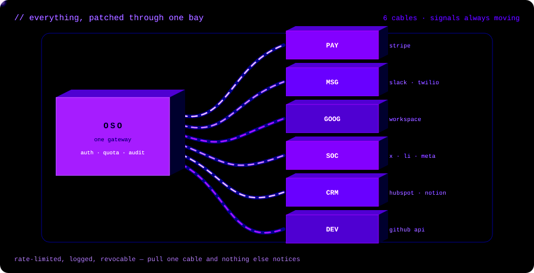

**The lesson in the bay:** integrations rot when they're special-cased. One gateway = one place for auth, quota, and audit — pull a cable and nothing else notices. Six categories through the same spine is how you add the seventh vendor in an afternoon.

---

## ◆ featured projects — award-winning · open source · production-ready

**Reading the shelf:** the shelf is the shortlist, not the archive. Abliteration proved what *breaks* before it proved what works; the bots run Elixir/Python in production; the SOP system placed in a hackathon. Pull any cartridge — each is a shippable lesson.

### ◈ AI Agent & Automation Projects

### ◈ Full-Stack & Backend Projects

### ◈ Frontend & Developer Resources

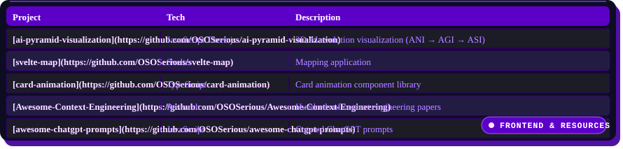

---

## ◆ what I deliver — production systems designed for agencies to deploy to clients

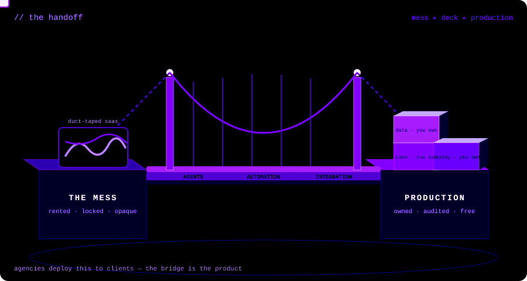

**The whole pitch, as one scene:** rented SaaS is a tangle you can't audit — the bridge carries it to code, data, and deploys you own, in three lanes (agents, automation, integration). The bridge *is* the product.

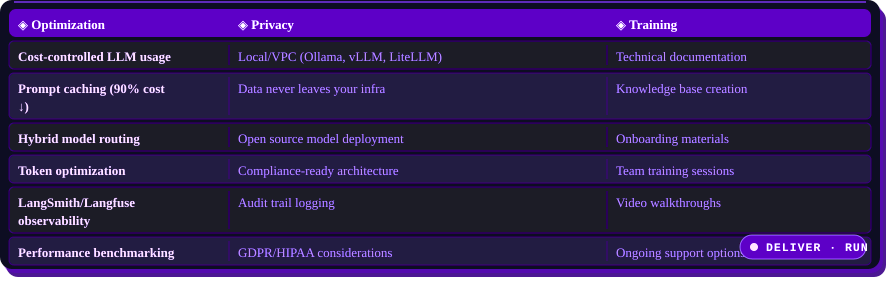

---

## ◆ github stats

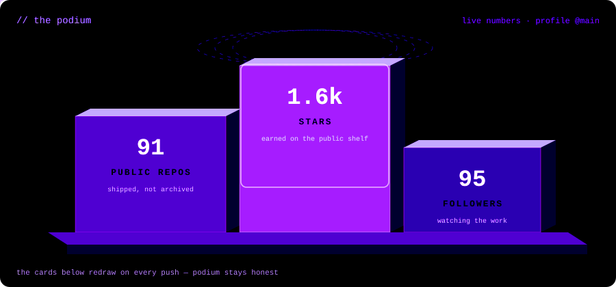

**The honest podium:** stars are other builders deciding your work was useful; repos are attempts; followers are people waiting on the next one. The cards below redraw on every push — no vanity, just receipts.

  
  

 

  

<!-- activity graph removed: public instance returning 402 for this account -->

---

  

 

  

 

  

  <i>No more renting disconnected software. I build infrastructure where you own the code and data, you control the deployment, you can audit every workflow, you can extend and customize freely, and you're not locked into vendor pricing.</i>

 

  <picture>
    <source media="(prefers-color-scheme: dark)" srcset="https://raw.githubusercontent.com/OSOSerious/OSOSerious/output/github-snake-dark.svg">
    <source media="(prefers-color-scheme: light)" srcset="https://raw.githubusercontent.com/OSOSerious/OSOSerious/output/github-snake.svg">
    
  </picture>
   
  

 

  

*I don't build demos — I build production systems.*

   

  

