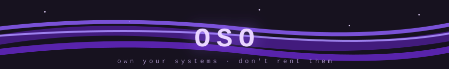

<!-- profile readme v5 @ full purple — all 44 SVG assets, all sections open, nothing from v3 dropped -->

  

  

### *own your systems, don't rent them.*
**Infrastructure you control, audit, and scale.**

  

 

| | |
|:--:|:--|
| ◈ | **AI agent automation frameworks** with production-grade orchestration |
| ◈ | **MCP-driven platforms** connecting LLMs to real tools and data |
| ◈ | **Multi-agent systems** with failover logic, memory, and human-in-the-loop |
| ◈ | **Private AI stacks** that never leave your infrastructure |

---

# ◆ THE WORK, ANIMATED — all of it

Every graphic below is **my own pure-SVG animation** living in this repo's `assets/` — no screenshots, no stock art, no external images for the animation layer. Each one is labeled with what it actually shows.

### ▸ RESEARCH — the Abliterator (published)

**What it shows:** five layer planes of Qwen2.5-1.5B, the bright **Δ(refusal)** vector, and the dashed **PCA basis (k=5) projecting it out at s=1.0** — HUD: **82%→5% refusal · 95% true compliance · 0% degeneration · ppl 13.18 · jailbreaks 82%→11%**. The real finding: *refusal lives in a ~5-dim subspace per layer* — [oso-obliterated-models](https://github.com/OSOSerious/oso-obliterated-models-) · [OSO-AI on Hugging Face](https://huggingface.co/OSO-AI). 15+ experiments, 4 negative results logged honestly.

### ▸ HOW THE SYSTEMS EXECUTE

**Plan-as-DAG, one mutation per node.** Nodes fire in dependency order, packets stream the edges, `write` sits behind a ✓ verify gate — nothing downstream runs until the gate passes.

**Findings survive, context doesn't.** Left: context compacted to ~10%. Right: findings lit with provenance (`ex:97`, `cli.py:412`) — bug → root-cause → fix-plan wired together.

**The only way data leaves.** `tools/call` out, `result [[LEAD]]` back, everything crosses the **anonymize gate at egress** — names become tokens before the server. The model never writes the sent text.

**Inventory by truth, not by claim.** A box rides the belt through XR-1; the screen reveals its skeleton — `db:5432`, `q:rabbit` — and stamps **SAFE ✓**.

**The thesis, as a factory line.** Duct-tape SaaS goes in, the OWN-IFIER press slams, identical owned modules come out stacked: db ✓ auth ✓ agents ✓ audit ✓.

**One intent, chain of steps.** Ball → teeter-totter → hammer → dominoes → bell → **SHIP ✓**. Your execution philosophy told as physical comedy, 7s loop.

### ▸ BUILT FROM THE PRODUCTS

**Goldclaw.ai as an arcade claw.** Cable drops, jaws grab a `[[TOKEN]]` off the lead belt, hauls it to the **SHIP** chute. Flagship loop: grab → process → ship.

**NewsTerminal / AutomateMedia press line.** Split-flap flips `BREAKING ▸ ANGLE ▸ SHIPPED (2:58 < 3:00)`, wire marquee runs the real content rules, REC dot pulses.

**Voiceprints.ai.** 22 breathing waveform bars, scan line sweeps, shackle clicks open on **MATCH ✓** — your voice is the key.

**Data never leaves your infrastructure.** Fans spin, drive LEDs blink in I/O rhythm, packets pulse down patch cables, LCD reads `gdpr: audit ON`.

**ROUTER-9000 — hybrid routing as a DJ desk.** Faders for GPT-5/CLAUDE/LOCAL ride themselves on SLA, VU meters bounce, cache LED reads **−90%**, master gauge: `0.31 → 0.04 $/1k tok`.

**Espresso pulls = pushes.** Press, portafilter fills, stream pulls into a cup labeled `main`, "shots today" ticks. Every deploy starts the same way.

### ▸ IDENTITY — proofs of the mark

src="https://raw.githubusercontent.com/OSOSerious/OSOSerious/main/assets/blueprint-mark.svg" width="100%" alt="Self-drawing blueprint"

**Self-drawing blueprint.** A plotter draws OSO with construction circles, then stamps the dimensions: `180° palindrome · favicon 16px · NO GRADIENT · DWG OSO-001 REV 5`.
 src="https://raw.githubusercontent.com/OSOSerious/OSOSerious/main/assets/kaleidoscope.svg" width="100%" alt="Kaleidoscope"

**Symmetry generated, not drawn.** Three mirror wedges rotate against a seed of your real contribution squares — infinite violet symmetry from finite work.

 src="https://raw.githubusercontent.com/OSOSerious/OSOSerious/main/assets/rorschach.svg" width="100%" alt="Rorschach palindrome"

**The palindrome, literal.** Your graph mirrored into an inkblot that breathes and flips through 180° — indistinguishable upside-down, because that IS the brand.
 src="https://raw.githubusercontent.com/OSOSerious/OSOSerious/main/assets/morse-beacon.svg" width="100%" alt="Morse beacon"

**The beacon.** OSO in Morse — `—··· ··· —···` — symmetric in that alphabet too. The palindrome holds everywhere.

 src="https://raw.githubusercontent.com/OSOSerious/OSOSerious/main/assets/wax-seal.svg" width="100%" alt="Wax seal"

**The seal.** A stamp presses OSO into violet wax over `signed-off-by` — provenance you can feel, same rule as the findings graph.
 src="https://raw.githubusercontent.com/OSOSerious/OSOSerious/main/assets/holo-identity.svg" width="100%" alt="Hologram"

**The projection.** The mark as a flickering hologram — identity that only exists while the system is powered.

 src="https://raw.githubusercontent.com/OSOSerious/OSOSerious/main/assets/metronome.svg" width="100%" alt="Metronome"

**The tempo.** 72 BPM, <i>consistency &gt; intensity</i> — how the shipping actually works: parallel threads, one steady beat.
 src="https://raw.githubusercontent.com/OSOSerious/OSOSerious/main/assets/rolling-ritual.svg" width="100%" alt="Convergence ritual"

**The convergence tick.** Your report ritual as HUD: pips fill, `[4] → [5]`, bar sweeps. Converge · report · repeat.

### ▸ MACHINES — the physics of the pipeline

src="https://raw.githubusercontent.com/OSOSerious/OSOSerious/main/assets/pinball.svg" width="100%" alt="Pinball failover"

**Failover as pinball.** The SHIP ball ricochets bumpers (`mcp · memory · harness`), flippers fire as retries, drain is **▼DEADLINE▼** — the ball never dies, it reroutes.
 src="https://raw.githubusercontent.com/OSOSerious/OSOSerious/main/assets/pachinko-router.svg" width="100%" alt="Pachinko router"

**Probability as hardware.** A token drops through SLA pins into `LOCAL / BALANCED / FRONTIER` buckets; cost meter flips `0.31 → 0.04`.

 src="https://raw.githubusercontent.com/OSOSerious/OSOSerious/main/assets/domino-plan.svg" width="100%" alt="Domino plan"

**One push, full cascade.** probe → plan → mutate → test → lint → build fall in sequence, last reveal **SHIP ✓**. "Deps = gravity."
 src="https://raw.githubusercontent.com/OSOSerious/OSOSerious/main/assets/marble-run.svg" width="100%" alt="Marble run"

**Merge discipline.** The marble waits at gates that only swing when `test ✓` and `review ✓` pass, then rolls into the **merged** bin.

 src="https://raw.githubusercontent.com/OSOSerious/OSOSerious/main/assets/lighthouse.svg" width="100%" alt="Lighthouse"

**Observability as weather.** The beam sweeps 360° through fog; your fleet's ships flip green → amber → green as light passes. `uptime 99.97`.
 src="https://raw.githubusercontent.com/OSOSerious/OSOSerious/main/assets/launch-countdown.svg" width="100%" alt="Launch countdown"

**Deploy ritual.** Split-flap digits 10…3…2, **LIFTOFF**, rocket rises past the checklist: `✓ 3252/3252 ✓ rollback staged ▸ canary 5%`.

 src="https://raw.githubusercontent.com/OSOSerious/OSOSerious/main/assets/slot-ship.svg" width="100%" alt="Slot SHIP"

**Jackpot logic.** Reels snap S·H·I·P, bell flashes, counters read `3,252 tests ✓ 0f` and commits ticking 240 → 242. Retro chrome, one Signal lever.
 src="https://raw.githubusercontent.com/OSOSerious/OSOSerious/main/assets/agent-elevator.svg" width="100%" alt="Agent elevator"

**The execution loop, as a building.** Car rides `PLAN → ACT → VERIFY → REMEMBER → SHIP`, doors hold at VERIFY — one floor per gate.

 src="https://raw.githubusercontent.com/OSOSerious/OSOSerious/main/assets/maze-runner.svg" width="100%" alt="Maze runner"

**Discovery through search.** Wrong turns dim, dead-ends re-route, the winning path locks in violet behind the token. Recon instinct, tiny game.
 src="https://raw.githubusercontent.com/OSOSerious/OSOSerious/main/assets/disk-vacuum.svg" width="100%" alt="Disk vacuum"

**The real session.** Vacuum eats the cache piles (lima · mix · go · brew), free-space gauge climbs `57GB → 128GB`, log reads: **no rm. moved. logged.**

### ▸ GENERATIVE — running on their own rules

src="https://raw.githubusercontent.com/OSOSerious/OSOSerious/main/assets/lava-plasma.svg" width="100%" alt="Lava plasma"

**Goo-filter metaballs.** `feGaussianBlur → feColorMatrix` makes five violet blobs — your five languages — fuse and split into one organism. Zero JS.
 src="https://raw.githubusercontent.com/OSOSerious/OSOSerious/main/assets/game-of-life.svg" width="100%" alt="Game of Life"

**Conway B3/S23 on your squares.** A glider crosses, a blinker rotates, a pulsar breathes — emergence from simple rules, your agent thesis in motion.

 src="https://raw.githubusercontent.com/OSOSerious/OSOSerious/main/assets/dna-helix.svg" width="100%" alt="DNA helix"

**The genome of shipping.** Two strands path-morphing through each other, base-pair rungs lighting in sequence, codon scanner sweeping. Code as life.
 src="https://raw.githubusercontent.com/OSOSerious/OSOSerious/main/assets/ship-oscope.svg" width="100%" alt="Ship oscilloscope"

**Your cadence as test equipment.** CRT waveform morphs calm → burst → spike (push days), glowing scan dot on the graticule: `TRIG ▸ AUTO · SIG: prod`.

 src="https://raw.githubusercontent.com/OSOSerious/OSOSerious/main/assets/repo-orbitals.svg" width="100%" alt="Repo orbitals"

**The constellation.** Repos on elliptical SMIL orbits around the OSO core — `harness · memory · mcp-tools · abliterate · erp · agents` — periods staggered so it never repeats the same way twice.
 src="https://raw.githubusercontent.com/OSOSerious/OSOSerious/main/assets/the-hive.svg" width="100%" alt="The hive"

**Swarm with no single point.** Scouts fly a real waggle-dance figure-8, hex cells fill with `[[TOKENS]]`, the queen cell pulses as orchestrator.

src="https://raw.githubusercontent.com/OSOSerious/OSOSerious/main/assets/contribution-koi.svg" width="100%" alt="Contribution koi"

**The koi, rebuilt.** A fish whose body IS your contribution squares, iso-shaded like the city — tail flicks, ripples. Your data, alive.
<td width="50%"></td>

### ▸ THE YEAR

**What it shows:** my real graph as an **isometric city** — every building is a day, towers rise on load, the radar sweeps the blocks. Violet depth ramp, zero green.

---

# ▸ languages — Elixir first

| Language | Proficiency | Use Cases |
|:---------|:------------|:----------|
| **Elixir** |  | **The first language.** Distributed systems, Phoenix LiveView, fault-tolerant architectures, event-driven backends, OTP supervision — the shape of everything else I build |
| **Python** |  | AI/ML, FastAPI/Django/Flask, automation, TensorFlow/PyTorch, Celery, data processing |
| **TypeScript** |  | Full-stack web dev, Node.js backends, React/Next.js, enterprise applications |
| **JavaScript** |  | Frontend development, Node.js, browser automation, scripting |
| **GraphQL** |  | Schema design, resolvers, subscriptions, Apollo Server/Client, Hasura |
| **SQL** |  | PostgreSQL (CTEs, window functions, JSONB), MySQL, query optimization, schema design |
| **Bash** |  | Scripting, automation, DevOps pipelines, CI/CD workflows |
| **Go** |  | High-performance backends, CLI tools, microservices. Projects: deep-wiki, osa-main |
| **Svelte** |  | Frontend apps, SvelteKit. Projects: cyber_agents, svelte-map |
| **Rust** |  | Systems programming, performance-critical components, WebAssembly |

---

# ▸ frameworks — Phoenix first

| Framework | Experience |
|:----------|:-----------|
| **Phoenix (Elixir)** | LiveView real-time UI, Channels for WebSockets, Ecto ORM, fault-tolerant architecture — my default for systems that must not fall over |
| **FastAPI** | High-performance Python APIs, async/await, OpenAPI docs, Pydantic validation, WebSocket support |
| **Django** | Full-stack Python, Django REST Framework, ORM optimization, admin panel, Celery integration |
| **Flask** | Lightweight REST APIs, Blueprint modularization, Flask-SQLAlchemy |
| **Express.js** | Node.js API framework, middleware patterns, Passport authentication |
| **Next.js** | Full-stack React, API routes, SSR/SSG/ISR, App Router, Server Components, Vercel deployment |
| **NestJS** | Enterprise Node.js, TypeScript-first, modular architecture, dependency injection, GraphQL |
| **SvelteKit** | Full-stack Svelte apps, server routes, form actions, adapter-based deployment |
| **gRPC** | Protocol Buffers, service definition, bidirectional streaming, service mesh integration |

### agent frameworks

| Framework | Detailed Experience |
|:----------|:--------------------|
| 🔷 **LangGraph 1.0** | Graph-based agent orchestration with state management, checkpointing for long-running workflows, LangGraph Studio for visual debugging, human-in-the-loop interrupts, conditional branching, parallel execution, production deployment patterns. |
| 🔷 **CrewAI** | Role-based multi-agent team orchestration with hierarchical process management, custom tool integration, agent delegation patterns, memory sharing between agents, production deployment of collaborative agent systems. |
| 🔷 **OpenAI Agents SDK** | Agent handoffs, built-in guardrails, native tool calling with structured outputs, tracing and observability, conversation management, GPT-5/o3/o4 model integration. |
| 🔷 **AutoGen / AG2** | Microsoft's multi-agent conversation framework (AutoGen 2.0/AG2), Semantic Kernel integration, conversational agents with code execution, group chat orchestration, enterprise deployment patterns. |
| 🔷 **Google ADK** | Google Agent Development Kit, Vertex AI Agent Engine integration, GCP-native deployment, BigQuery and Cloud Storage tool access, enterprise-scale agent systems. |
| 🔷 **MCP Protocol** | Model Context Protocol server development, custom tool integration, resource management, A2A interoperability, MCP server for Browserbase, production MCP deployments. |
| 🔷 **LangChain** | Chains, agents, memory systems (ConversationBufferMemory, VectorStoreMemory), document loaders (PDF, DOCX, HTML, CSV), retrievers, LangSmith observability, LCEL expression language. |
| 🔷 **LlamaIndex** | RAG-first agent framework with query engines, data connectors, index optimization, enterprise retrieval patterns, structured output parsing, hybrid search implementations. |
| 🔷 **Swarm (OpenAI)** | Lightweight agent orchestration for simple multi-agent handoffs, context variable passing, function-based agent transitions. |
| 🔷 **Flowise / Dify** | Low-code LLM flow builders for visual agent design, custom node development, API deployment, rapid prototyping of agent workflows. |
| 🔷 **Claude Code** | AI-powered development with Claude, MCP server development, agent automation, codebase analysis, multi-file code generation. |
| 🔷 **Custom Agent Harnesses** | Built agent runtimes from scratch — event-driven loops, multi-provider routing, plan-as-DAG execution (one mutation per node), persistent memory with confidence decay, checkpoint/restore, and embedded object storage. |

---

# ▸ models & providers

| Provider | Models & Experience |
|:---------|:--------------------|
| ⚡ **OpenAI** | GPT-5 (latest flagship), GPT-4o (multimodal), o3-pro and o4-mini (reasoning), OpenAI Agents SDK, Assistants API with retrieval and code interpreter, Codex, Embeddings API (text-embedding-3-large), Whisper, DALL-E 3. |
| ⚡ **Anthropic** | Claude 4.5 (Opus/Sonnet), extended thinking, tool use, prompt caching (90% cost ↓), batch processing, MCP server development. |
| ⚡ **Google** | Gemini 2.5 Pro/Flash, Vertex AI Agent Engine, AI Studio, grounding with Google Search, Gemini Code Assist. |
| ⚡ **DeepSeek** | DeepSeek-V3.1 (671B parameters, MoE architecture), DeepSeek-R1 reasoning model (MIT license), R1-Distill variants for efficient deployment, open-weight with commercial use. |
| ⚡ **Alibaba (Qwen)** | Qwen 3 (235B MoE, flagship), Qwen 2.5 Coder 32B (code-specialized), Qwen-Math, Qwen-VL, open-weight Apache 2.0 license. |
| ⚡ **Zhipu (GLM)** | GLM-5.x family for agentic coding — provider routing between flash and full tiers, OpenAI/Anthropic-compatible endpoint integration, cost/performance tuning for daily agent workloads. |
| ⚡ **Groq** | LPU (Language Processing Unit) accelerated inference, ultra-fast token generation, Llama and Mixtral hosting, production API with consistent low latency. |
| ⚡ **Self-Hosted** | Ollama (local LLM deployment), vLLM (high-throughput serving, prefix-cache economics), LiteLLM (unified API with cost tracking), NVIDIA Triton Inference Server, Text Generation Inference (TGI), llama.cpp (CPU/GPU inference). |

---

# ▸ databases & vector stores

| Database | Experience |
|:---------|:-----------|
| **PostgreSQL** | Primary DB, CTEs, window functions, JSONB, full-text search, pgvector for embeddings, replication |
| **Redis** | In-memory store, caching, pub/sub messaging, streams, session storage, rate limiting |
| **MongoDB** | Document database, aggregation pipelines, Atlas cloud deployment |
| **Supabase** | Postgres + Auth + Storage + Realtime subscriptions, Row Level Security, edge functions |
| **Neon** | Serverless Postgres, branching for development, autoscaling, Vercel integration |
| **Qdrant** | Vector database for semantic search, embeddings storage, filtering, hybrid search, production RAG |
| **Pinecone** | Managed vector database, similarity search, metadata filtering, serverless deployment |
| **ChromaDB** | Local vector database, Python-native, rapid prototyping |
| **FAISS** | Facebook AI Similarity Search, high-performance vector indexing, billion-scale search |
| **Elasticsearch** | Full-text search, analytics, log aggregation, vector search capabilities |

---

# ▸ message queues & events

| Technology | Experience |
|:-----------|:-----------|
| **Redis Pub/Sub** | Real-time messaging, event distribution, inter-agent communication at The Swarms Corporation |
| **Redis Streams** | Persistent message queues, consumer groups, exactly-once processing |
| **Apache Kafka** | Event streaming platform, high-throughput ingestion, topic partitioning, log compaction |
| **RabbitMQ** | AMQP message broker, queue management, exchange patterns (direct, topic, fanout) |
| **Celery** | Python distributed task queue, periodic tasks with Celery Beat, canvas workflows |
| **BullMQ** | Node.js job queue, Redis-backed, delayed jobs, rate limiting, job prioritization |
| **AWS SQS** | Managed message queue, FIFO queues, dead letter queues, Lambda integration |

---

# ▸ automation & orchestration

| Technology | Experience |
|:-----------|:-----------|
| **n8n** | Production workflows, custom node development, LangChain nodes, Claude integration, webhook orchestration, self-hosted deployment |
| **Custom n8n Nodes** | TypeScript node development, credential handling, pagination, error handling, testing |
| **Temporal** | Durable workflow execution, long-running processes, saga patterns, workflow versioning |
| **Apache Airflow** | Data pipeline orchestration, DAG authoring, scheduling, monitoring, XComs |
| **Playwright** | Browser automation, E2E testing, web scraping (google-shopping-playwright-scraper), cross-browser |
| **Puppeteer** | Chrome automation, PDF generation, screenshot capture, web scraping |
| **Browserbase** | Cloud browser infrastructure, MCP server integration (mcp-server-browserbase) |

---

# ▸ cloud & devops

| Technology | Experience |
|:-----------|:-----------|
| **Docker** | Containerization, multi-stage builds, Docker Compose, image optimization |
| **Kubernetes** | Container orchestration, deployments, services, ingress, ConfigMaps, Helm charts |
| **Terraform** | Infrastructure as Code, provider management, state management, modules |
| **AWS** | EC2, S3, Lambda, ECS, RDS, SQS, SNS, API Gateway, CloudFront, IAM, CloudWatch |
| **Google Cloud** | Compute Engine, Cloud Run, Cloud Functions, BigQuery, Vertex AI |
| **Vercel** | Frontend deployment, serverless functions, Edge Runtime, Next.js optimization |
| **Cloudflare** | CDN, Workers (serverless), R2 storage, D1 database, DNS management, DDoS protection |
| **GitHub Actions** | CI/CD pipelines, automated testing, deployment workflows, matrix builds |

---

# ▸ observability, monitoring & security

| Technology | Experience |
|:-----------|:-----------|
| **LangSmith** | LLM observability, trace visualization, prompt debugging, cost tracking, evaluation datasets |
| **Langfuse** | Self-hosted LLM tracing, open-source observability, prompt management |
| **Prometheus** | Metrics collection, time-series database, alerting rules, PromQL queries |
| **Grafana** | Dashboards, visualization, alerting, data source integration, Loki for logs |
| **Datadog** | APM, logging, infrastructure monitoring, distributed tracing |
| **Sentry** | Error tracking, performance monitoring, release tracking |
| **OpenTelemetry** | Distributed tracing, metrics, logs, vendor-agnostic instrumentation |

**Security:** OAuth 2.0 · JWT · HashiCorp Vault · SSL/TLS · API Keys

**Testing:** Pytest · Jest · Vitest · Playwright · Cypress · k6

**AI/ML infra:** Hugging Face · NVIDIA Triton · vLLM · ONNX · scikit-learn · TensorFlow · PyTorch

---

# ▸ API integrations

| Category | Integrations |
|:---------|:-------------|
| 💳 **Payments** | Stripe (subscriptions, webhooks, Connect, Checkout, Payment Intents) |
| 💬 **Communication** | Slack API, Discord API, Twilio (SMS, Voice, WhatsApp), SendGrid, Mailgun |
| 📊 **Google** | Calendar, Docs, Sheets, Gmail, Drive |
| 🌐 **Social** | Twitter/X API, Facebook Graph API, LinkedIn API |
| 🏢 **CRM** | HubSpot API, Salesforce API, Notion API, Airtable API |
| 👨‍💻 **Developer** | GitHub API (repository automation, webhooks, Actions) |

---

# ▸ featured projects — award-winning · open source · production-ready

### 🤖 AI Agent & Automation Projects

| Project | Tech | Description |
|:--------|:-----|:------------|
| [discord-bot (NEXUS-PRIME)](https://github.com/OSOSerious/discord-bot) | `Python` `Red-DiscordBot` | Multi-agent research orchestrator — 4-stage pipeline (Scout → Analyst → Validator → Synthesizer), fan-out/fan-in concurrency, semantic caching, per-command USD budget caps |
| [oso-obliterated-models-](https://github.com/OSOSerious/oso-obliterated-models-) | `Python` `Transformers` | Refusal-direction abliteration pipeline (Arditi et al.) — matched-pair extraction, inference-time projection removal, honest evals: Qwen2.5-1.5B 97.5%→0% refusal, 0% false-refusal, +57% ppl |
| [discord-translation-bot](https://github.com/OSOSerious/discord-translation-bot) | `Elixir` | English↔Spanish Discord bot — slash commands + per-channel auto-translate, ETS-cached, pluggable backends (DeepL/LibreTranslate), .txt file translation |
| [oso-sec](https://github.com/OSOSerious/oso-sec) | `Python` | Security toolkit — passive audit SDK for owned assets + loopback-only exploit lab with validated detection engineering |
| [Enhance-SOP-of-Prompts](https://github.com/OSOSerious/Enhance-SOP-of-Prompts) | `TypeScript` `LangGraph` | 🏆 **Hackathon 2nd Place** — Self-optimizing SOP system with continuous improvement loops |
| [Real-Estate-Optimizer-swarm](https://github.com/OSOSerious/Real-Estate-Optimizer-swarm) | `Python` `Swarm` | Multi-agent swarm for real estate optimization |
| [Google-ADK-Agents](https://github.com/OSOSerious/Google-ADK-Agents) | `Python` `Google ADK` | Google Agent Development Kit implementations |
| [agent-template-groq](https://github.com/OSOSerious/agent-template-groq-) | `Python` `Groq LPU` | Ultra-fast inference agent template |
| [content-curation-agent](https://github.com/OSOSerious/content-curation-agent) | `JavaScript` | Content curation & aggregation — automated newsletter updates, central topic feeds |
| [ClaudeBlogAutomation](https://github.com/OSOSerious/ClaudeBlogAutomation) | `Svelte` | AI-assisted blog + social content generation |
| [cyber_agents](https://github.com/OSOSerious/cyber_agents) | `Svelte` | Cyber agents management interface |
| [Agents](https://github.com/OSOSerious/Agents) | `Multi-Framework` | Collection of agent implementations |
| [everything-n8n](https://github.com/OSOSerious/everything-n8n) | `Node.js` `n8n` | Comprehensive n8n resources + Claude integration |
| [awesome-n8n](https://github.com/OSOSerious/awesome-n8n) | `n8n` | Curated n8n workflows and resources |

### 🔧 Full-Stack & Backend Projects

| Project | Tech | Description |
|:--------|:-----|:------------|
| [Basic-chat-ui-for-llms-with-tool-use](https://github.com/OSOSerious/Basic-chat-ui-for-llms-with-tool-use) | `TypeScript` | Chat UI with LLM tool-use rendering |
| [google-shopping-scraper](https://github.com/OSOSerious/google-shopping-playwright-scraper) | `Python` `Playwright` | E-commerce data extraction |
| [ai-and-google-doc](https://github.com/OSOSerious/ai-and-google-doc) | `TypeScript` | Google Docs + AI integration |
| [emil-chatbot](https://github.com/OSOSerious/emil-chatbot) | `TypeScript` | Custom chatbot implementation |
| [deep-wiki](https://github.com/OSOSerious/deep-wiki) | `Go` | Knowledge management system |
| [miosa-insight-forge](https://github.com/OSOSerious/miosa-insight-forge) | `TypeScript` | Insight generation platform |
| [vercel-neon-postgres](https://github.com/OSOSerious/vercel-with-neon-postgres) | `TypeScript` | Vercel + Neon Postgres template |
| [fullstack-app-generator-bolt](https://github.com/OSOSerious/fullstack-app-generator-bolt) | `TypeScript` | Full-stack app generator |

### 🎨 Frontend & Developer Resources

| Project | Tech | Description |
|:--------|:-----|:------------|
| [ai-pyramid-visualization](https://github.com/OSOSerious/ai-pyramid-visualization) | `JavaScript` `Three.js` | 3D AI evolution visualization (ANI → AGI → ASI) |
| [svelte-map](https://github.com/OSOSerious/svelte-map) | `Svelte` | Mapping application |
| [card-animation](https://github.com/OSOSerious/card-animation) | `TypeScript` | Card animation component library |
| [Awesome-Context-Engineering](https://github.com/OSOSerious/Awesome-Context-Engineering) | `Research` | Hundreds of context engineering papers |
| [awesome-chatgpt-prompts](https://github.com/OSOSerious/awesome-chatgpt-prompts) | `JavaScript` | Curated ChatGPT prompts |

---

# ▸ what I deliver — production systems designed for agencies to deploy to clients

| 🤖 AI Agents | ⚙️ Automation | 🔌 Integration |
|:-------------|:--------------|:---------------|
| Multi-agent systems (LangGraph/CrewAI) | n8n workflows + LLM integrations | API design & documentation |
| Tool calling with structured outputs | Custom n8n node development | Webhooks & event handling |
| MCP Protocol integration | API orchestration and chaining | Data synchronization patterns |
| Persistent memory (Qdrant, Pinecone) | Event-driven architecture | Stripe, Google, Slack, CRMs |
| Human-in-the-loop approval | Background job processing | Migration planning |
| GPT-5, Claude 4.5, Llama 4 support | Webhook management | Legacy system integration |

| 🎯 Optimization | 🔒 Privacy | 🎓 Training |
|:----------------|:------------------------|:-----------------|
| Cost-controlled LLM usage | Local/VPC (Ollama, vLLM, LiteLLM) | Technical documentation |
| Prompt caching (90% cost ↓) | Data never leaves your infra | Knowledge base creation |
| Hybrid model routing | Open source model deployment | Onboarding materials |
| Token optimization | Compliance-ready architecture | Team training sessions |
| LangSmith/Langfuse observability | Audit trail logging | Video walkthroughs |
| Performance benchmarking | GDPR/HIPAA considerations | Ongoing support options |

---

# ▸ github stats

  
  

 

  

<!-- activity graph removed: public instance returning 402 for this account -->

---

  

 

  

 

  

  <i>No more renting disconnected software. I build infrastructure where you own the code and data, you control the deployment, you can audit every workflow, you can extend and customize freely, and you're not locked into vendor pricing.</i>

 

  <picture>
    <source media="(prefers-color-scheme: dark)" srcset="https://raw.githubusercontent.com/OSOSerious/OSOSerious/output/github-snake-dark.svg">
    <source media="(prefers-color-scheme: light)" srcset="https://raw.githubusercontent.com/OSOSerious/OSOSerious/output/github-snake.svg">
    
  </picture>
   
  

 

  

*I don't build demos — I build production systems.*

   

  

